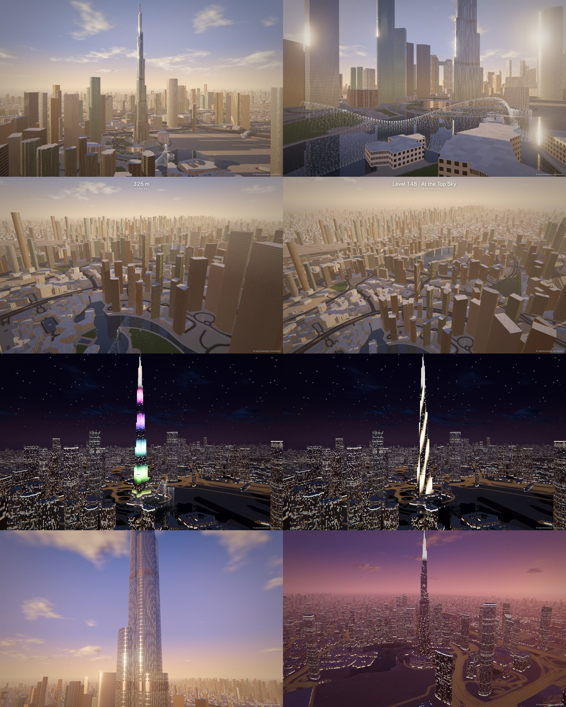

# Burj Khalifa

The Burj Khalifa and Downtown Dubai, rendered live in the browser with three.js (WebGL2).

**Live:** https://afthab-in.github.io/burj-khalifa/



## Things to do

- **Click the lake:** the fountain show. About 50 seconds of choreographed jets (sways, shooters, a running wave, a 140 m finale) to an original piece synthesised in your browser.
- **Click the tower:** the facade light show, with five patterns. It is strongest after dark.
- **Shot › Elevator:** ride up the facade to level 124 (452 m) or level 148 (555 m), then drag to look around from the deck.
- **Time:** from morning haze to midday, golden hour, sunset, blue hour and night, with a time slider and a day cycle. Windows, crowns, streets and the spire light up through dusk.
- Drag and scroll to orbit and zoom. `1` to `5` play camera shots, `0` stops. `F` fountain, `L` light show, `E` elevator, `T` next time of day, `H` hides the bar.

## Run it

```bash
npm install
npm run dev
```

Then open http://localhost:5244.

## How it is built

| File | What it does |
|---|---|
| `scripts/fetch_osm.py` | Downloads about 4.5 × 4.5 km of Downtown Dubai from the OpenStreetMap API in tiles, splitting any tile over the node limit. |
| `scripts/build_city.py` | Builds `public/data/city.json`: building footprints and heights, roads, rail, water, green areas and plazas, in metres around the tower. The Burj Khalifa comes from its mapped 3D parts: 29 `building:part`s are merged into 27 tiers, one per setback, from 35 m up to the 828 m tip. |
| `src/tower.ts` | The tower's facade: reflective glass, vertical steel fins, floor lines, plant-room bands and a steel spire. At night: lit floors, a floodlit spire, red aviation beacons, and the LED light show. |
| `src/city.ts` | One facade shader for every other building (glass curtain walls on towers, punched windows on low-rise, shopfronts, crowns, lit windows at night). Procedural blocks and a Sheikh Zayed Road tower line carry the city on past the mapped area. |
| `src/ground.ts` | A 4096² ground map painted from the real roads, parks, plazas and water, with streetlight glow at night; procedural city fabric beyond, and the Gulf to the north-west. |
| `src/water.ts`, `src/reflection.ts` | Reflective water with a planar reflection of the tower. |
| `src/fountain.ts`, `src/music.ts` | The fountain line is the longest clear run through the Burj Lake, with two rings. A choreography writes each nozzle's height, sway and light into a float texture that GPU particles read. The music is an original D Hijaz piece made with WebAudio, timed to the jets. |
| `src/sky.ts` | Sky, sun path for Dubai's latitude, clouds, haze, stars, and time-of-day keys. |
| `tools/shoot.cjs` | Headless Chrome (GPU) screenshots and timings for QA. Set `PW_CORE` to a playwright-core path. |

Every push to `main` builds and deploys to GitHub Pages (`.github/workflows/pages.yml`).

## Credits

Map data © OpenStreetMap contributors, available under the Open Database License (https://www.openstreetmap.org/copyright). Heights not tagged in OpenStreetMap are estimated from floor counts or footprint size. The fountain choreography and music are original, not the real show.
